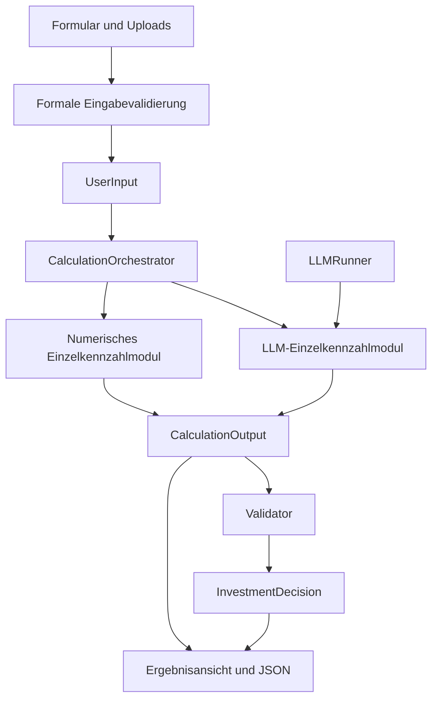

# Umsetzungskonzept – Heat Pump Ready

## 1. Zweck und Architekturentscheidung

Die Anwendung liefert eine nachvollziehbare erste Wärmepumpeneinschätzung im lokalen Browser. Ihr Kern ist eine schrittweise Pipeline mit drei strikt getrennten Verantwortungen:

1. **Eingabe:** UI-Werte und Dateien in eine unveränderliche Dataclass übertragen.
2. **Berechnung:** Austauschbare Module ermitteln jeweils genau eine Kennzahl. Ein Orchestrator sammelt ihre Ergebnisse in einer Output-Dataclass.
3. **Validierung und Entscheidung:** Ein abschließender Validator prüft die Kennzahlen und entscheidet, ob sich eine Investition unter den dokumentierten Annahmen lohnt.

Numerisch berechenbare Größen werden numerisch berechnet. LLMs sind ausschließlich Werkzeuge für begrenzte Extraktionsaufgaben, beispielsweise die Erkennung eines Heizkörpertyps. Das Modell formuliert keine Investitionsempfehlung und ersetzt keine Formeln.

Das Konzept setzt die Vorgaben aus [CODING_PRINCIPLES.md](CODING_PRINCIPLES.md) auf diese Fachdomäne um. Die dortigen ROS-Topics, Szenenfenster, Koordinatensysteme und Zeittrigger sind domänenspezifische Beispiele und werden nicht künstlich nachgebaut.

## 2. Anforderungen und Abgrenzung

### 2.1 Funktionale Anforderungen

- Lokal im Browser aufrufbare Website.
- Vollständige Eingabe vor Übergabe an den Berechnungsstack.
- Eine gemeinsame `UserInput`-Dataclass einschließlich Rechnungen und Bildern.
- Konfigurierbare, sequenzielle Liste von Berechnungsmodulen.
- Genau ein fachlicher Output pro Modul.
- Explizite Abhängigkeiten zwischen Kennzahlen.
- Gemeinsame, unveränderliche Output-Sicht für nachfolgende Module.
- Numerische und LLM-gestützte Module mit gleichem Vertrag.
- Austauschbarer lokaler oder API-basierter `LLMRunner`.
- Ergebnisdarstellung mit Einheiten, Quellen und Unsicherheit.
- Getrennter Validator für Plausibilität und Investitionsentscheidung.
- Demonstrationsannahmen sichtbar markieren.
- Ergebnisexport als JSON.

### 2.2 Nicht als abgeschlossen zu verstehen

Der MVP bietet keine normgerechte Heizlastberechnung, keine vollständige Heizkörperdimensionierung, keine verbindliche Förderprüfung und keine belastbare Finanzplanung. Außenstandortfotos können hochgeladen werden, werden aber noch nicht bewertet. PDF-Dateien werden angenommen, jedoch noch nicht in Seitenbilder gerendert oder automatisch ausgewertet. Für modellgestützte Rechnungserkennung sind JPG/PNG erforderlich.

## 3. Technologie und lokaler Betrieb

Der implementierte MVP verwendet Python ab 3.9 sowie HTML, CSS und JavaScript ohne Build-Schritt. Der HTTP-Server stammt aus der Python-Standardbibliothek und bindet ausschließlich an `127.0.0.1`. Pflichtabhängigkeiten oder eine Datenbank sind nicht erforderlich.

Dies ist eine bewusste Vereinfachung des ursprünglich vorgeschlagenen FastAPI/Pydantic-Aufbaus: In der vorliegenden Umgebung ist Python bereits vorhanden; für wenige lokale Endpunkte genügt ein kleiner Standardbibliothek-Adapter. Die fachliche Pipeline importiert keine HTTP-Klassen. Ein späterer FastAPI-Adapter kann deshalb dieselben Dataclasses und Dienste verwenden.

Der Server ist ein lokaler Entwicklungs- und Hackathonserver, kein öffentliches Produktionshosting. Modellbibliotheken sind optional und werden erst beim ausgewählten MLX-Modus importiert. Es werden keine Modelle automatisch als Voraussetzung des Standardstarts installiert.

Start:

```bash
python3 -m heat_pump_ready
```

Browser: `http://localhost:8000`.

## 4. Datenfluss und Abhängigkeitsrichtung



Das Diagramm zeigt fachlichen Datenfluss. Die Importstruktur ist einfacher: Verträge hängen nicht von Diensten ab; Module importieren Verträge und gegebenenfalls Runner-Schnittstellen; der Orchestrator kennt nur Modulverträge; der Server setzt alles zusammen.

Eine Kennzahl wird einmal berechnet. Nachfolgende Module lesen denselben Snapshot, statt eine fremde Formel zu duplizieren. Darstellung und Export konsumieren exakt dieselben Resultate.

## 5. Eingabepipeline

### 5.1 Verantwortung

`intake.build_user_input(payload)` nimmt ein JSON-Objekt entgegen und gibt `UserInput` zurück. Zahlenformate, endliche Werte, Wertebereiche, Enumerationen und Dateien werden geprüft. Bei ungültigen Werten entsteht ein verständlicher Fehler mit Feldbezug.

Diese Stufe lädt keine Modelle, interpretiert keine Fotos und bewertet keine Wirtschaftlichkeit. Sie darf nicht heimlich fehlende Angaben ergänzen.

### 5.2 Eingabevertrag

| Feld | Typ | Einheit / Bedeutung |
|---|---|---|
| `construction_year` | optional int | Baujahr |
| `floor_area_m2` | optional float | Beheizte Fläche in m² |
| `renovation_status` | enum string | unknown, unrenovated, partially, fully, low_energy |
| `annual_consumption` | optional float | Rohverbrauch in gewählter Einheit |
| `consumption_unit` | enum string | kwh, litre, m3 |
| `energy_carrier` | enum string | gas, oil, lpg, district, electric |
| `persons_in_household` | optional int | Personenanzahl |
| `hot_water_via_heating` | optional bool | True, False oder unbekannt |
| `heat_distribution` | enum string | unknown, radiators, underfloor, mixed |
| `pipe_system` | enum string | unknown, single-pipe, two-pipe |
| `flow_temperature_c` | optional float | Erforderlicher Vorlauf in °C |
| `investment_eur` | optional float | Geschätzte Bruttoinvestition |
| `subsidy_eur` | optional float | Explizite Förderannahme, gegebenenfalls 0 |
| `horizon_years` | float | Betrachtungszeitraum, Standard 20 Jahre |
| `location` | string | Freiwillige Standortangabe |
| `notes` | string | Freitext, noch ohne rechnerische Auswertung |
| `attachments` | tuple[Attachment] | Unveränderliche Dateipayloads |

### 5.3 Dateiinhalt und Lebensdauer

`Attachment` enthält `name`, `media_type`, `category` und `content`. Der MVP hält Bytes in der Dataclass statt temporäre Dateipfade zu erzeugen. Alle Module erhalten dasselbe Objekt; Inhalte werden nicht pro Modul kopiert. Die vereinfachte Speicherstrategie benötigt keine Upload-Datenbank und keine Dateibereinigung.

Zugelassen sind JPEG, PNG und PDF mit passender Dateisignatur. Grenzen: sechs Dateien mit jeweils höchstens 4 MiB. Eine Anfrage ist auf 34 MiB begrenzt, um Base64-Overhead abzudecken. Dateien bleiben im Browser bis Entfernen oder Neuladen und serverseitig während der Anfrage. Es gibt keine dauerhafte serverseitige Speicherung.

Dateikategorien: `bill`, `radiator`, `pipes`, `outdoor`. Eine Kategorie steuert die fachlich relevante Auswahl; ein Heizkörpermodul sieht keine beliebigen Rechnungsfotos.

## 6. Berechnungsmodule

### 6.1 Vertrag

`CalculationModule` ist ein `Protocol` mit:

- `name`: stabiler Modulname.
- `output_key`: genau ein Zielfeld in `CalculationOutput`.
- `requires`: Tuple der benötigten vorherigen Kennzahlen.
- `calculate(user_input, previous_results) -> MetricResult`.

Eingabe und vorherige Resultate sind unveränderlich. Ein Modul darf keine anderen Module starten, keine Output-Felder setzen und keine Investitionsentscheidung erzeugen.

Die Hilfsklasse `MetricModule` stellt nur kleine Konstruktoren für verfügbare oder fehlende Kennzahlen bereit. Es gibt keine tiefe Vererbungshierarchie. Fachlich zusammengehörige gemeinsame Extraktionsvalidierung liegt in `ExtractionModule`.

### 6.2 Was „genau eine Kennzahl“ bedeutet

Eine Kennzahl kann numerisch, kategorial oder eine numerische Spanne sein. Eine Spanne für eine Heizlast ist weiterhin eine Kennzahl; Heizlast plus Kosten plus Empfehlung wären drei verschiedene Verantwortungen.

Jedes Ergebnis darf zusätzliche Herkunft, Belege und Unsicherheit enthalten. Diese Metadaten sind keine weiteren Fachkennzahlen.

### 6.3 Numerische Module

| Modul | Output | Abhängigkeiten | Formel / Verhalten |
|---|---|---|---|
| AnnualConsumptionModule | annual_consumption | keine | Nutzerverbrauch normalisieren, alternativ Rechnungsbild extrahieren |
| UsefulHeatModule | useful_heat | annual_consumption | Verbrauch × Kesselnutzungsgrad |
| HotWaterDemandModule | hot_water_demand | keine | Personen × 1.000; bei separatem Warmwasser 0; ohne Personenzahl 0, als Unsicherheit gekennzeichnet |
| SpaceHeatingDemandModule | space_heating_demand | useful_heat, hot_water_demand | Nutzwärme minus Warmwasser |
| ConsumptionHeatLoadModule | heat_load_consumption | space_heating_demand | Raumwärme ÷ Volllaststunden |
| AreaHeatLoadModule | heat_load_area | keine | Fläche × W/m²-Spanne der Gebäudeklasse ÷ 1.000 (Klassenleiter, siehe [docs/HEIZLAST_M4.md](docs/HEIZLAST_M4.md)) |
| HeatLoadEstimateModule | heat_load | heat_load_area (optional: heat_load_consumption) | Verbrauchswert, wenn er in der Gebäudeklasse liegt; sonst Bandmitte bzw. höherer Wert mit Hinweis |
| AnnualPerformanceFactorModule | annual_performance_factor | keine | Feste JAZ-Zuordnung aus Heizflächen und Vorlauf |
| CurrentEnergyCostModule | current_energy_cost | annual_consumption | Verbrauch × Brennstoffpreis |
| HeatPumpEnergyCostModule | heat_pump_energy_cost | useful_heat, annual_performance_factor | Nutzwärme ÷ JAZ × Strompreis |
| AnnualSavingsModule | annual_savings | current_energy_cost, heat_pump_energy_cost | Heutige minus zukünftige Energiekosten |
| NetInvestmentModule | net_investment | keine | Investition minus Förderung |
| PaybackPeriodModule | payback_period | annual_savings, net_investment | Nettoinvestition ÷ Ersparnis |
| HorizonModule | horizon | keine | Gewählten Betrachtungszeitraum übernehmen |

`HorizonModule` überführt einen Entscheidungsparameter als einzelne Kennzahl in den Output. Dadurch benötigt der Validator keinen versteckten Zugriff auf `UserInput`.

### 6.4 Numerische Randfälle

- Öl-Liter und Erdgas-m³ werden näherungsweise mit Faktor 10 umgerechnet. Nicht passende Kombinationen bleiben nicht berechenbar.
- Für Flüssiggas wird kein Erdgaspreis verwendet.
- Bei unbekannter Warmwasserbereitung bleibt der Raumwärmebedarf offen; die gesamten Energiekosten können weiterhin berechnet werden.
- Negative Raumwärme wird nicht auf null gekappt. Der Validator sieht den Widerspruch und verhindert eine positive Entscheidung.
- Nutzungsgrad 0,88 wird nur für die unterstützten Brennstoffkessel angewandt, nicht ungeprüft auf Fernwärme oder Elektroheizung.
- Für Mischsysteme ist eine bekannte gemeinsame erforderliche Vorlauftemperatur notwendig. Es wird keine mittlere JAZ erfunden.
- Für Vorlauf über 60 °C fehlt eine definierte JAZ; das Modul liefert unbekannt.
- Bei Ersparnis ≤ 0 ist die Amortisationskennzahl `no_finite_payback`, keine Division durch null und kein unendlicher JSON-Zahlenwert.
- Baujahre ohne Challenge-Klasse (1979, 2000, 2001), Teilsanierung und unbekannter Sanierungsstand werden über eine Klassenleiter eingestuft. Eigene Ergänzungen sind als Demoannahme gekennzeichnet; die frühere Notspanne 40–180 W/m² entfällt. Details und Quellenstatus: [docs/HEIZLAST_M4.md](docs/HEIZLAST_M4.md).

### 6.5 LLM-Module

`PipeSystemModule` bevorzugt eine bekannte Nutzerangabe. Andernfalls werden ausschließlich Rohr-/Anschlussbilder ausgewertet. Zwei sichtbare Anschlüsse und H-Blöcke reichen allein nicht aus. Erlaubte Werte sind `single-pipe` und `two-pipe`; nicht belegbare Aussagen bleiben unbekannt.

`RadiatorTypeModule` liefert Typ 11, 22 oder 33 für genau einen abgebildeten Heizkörper. Bei mehreren Fotos wird keine Gebäudekategorie aus möglicherweise verschiedenen Heizkörpern erfunden. Größe, Leistung und Eignung werden nicht aus dem Typ allein abgeleitet.

`AnnualConsumptionModule` ist der einzige Produzent des normalisierten Jahresverbrauchs. Wenn ein Nutzerwert fehlt, darf es einen expliziten Jahresverbrauch in kWh aus einem Rechnungsbild extrahieren. Keine Monatswerte hochrechnen und keine Zählerstände als Verbrauch übernehmen. Die Herkunft bleibt als unbestätigte LLM-Schätzung sichtbar.

Alle Extraktionsantworten werden als JSON mit exakt `value`, `evidence` und `confidence` erwartet. Ein unzulässiger Datentyp oder eine nicht erlaubte Kategorie erzeugt `failed`; `value=null` bedeutet nicht erkennbar. Modellinhalt wird nicht als ausführbarer Code oder HTML verwendet.

## 7. Orchestrator

### 7.1 Initialisierung

`CalculationOrchestrator(modules, disabled)` erhält eine explizit geordnete Liste und deaktivierte Kennzahl-Keys. Er prüft vor der Ausführung:

- bekannte Output-Felder;
- höchstens einen Produzenten pro Feld;
- bekannte Abhängigkeiten;
- korrekte Reihenfolge, soweit die Produzenten im Stack vorhanden sind;
- gültige Deaktivierungs-Keys.

### 7.2 Lauf

1. Output mit allen bekannten Feldern im Zustand `disabled` erstellen.
2. Module sequenziell durchlaufen.
3. Deaktivierte Module überspringen.
4. Verfügbarkeit deklarierter Vorberechnungen prüfen.
5. Bei fehlenden Voraussetzungen genau ein `blocked`-Ergebnis einsetzen.
6. Andernfalls Modul ausführen.
7. Output-Key, Status und Vorhandensein des Werts prüfen.
8. Demonstrationsherkunft aus Abhängigkeiten weitergeben.
9. Einen neuen unveränderlichen Output-Snapshot mit dem neuen Ergebnis erstellen.
10. Vollständige `CalculationOutput` zurückgeben.

Es gibt keine automatische dynamische Plugin-Suche, keine parallele Bearbeitung gemeinsam veränderlicher Zustände und keinen zweiten Berechnungsweg im Frontend.

### 7.3 Erweiterung

Für eine neue Kennzahl:

1. Bedeutung, Einheit, zulässige Werte und unbekanntes Verhalten dokumentieren.
2. Feld in `CalculationOutput` ergänzen.
3. Ein Modul mit genau diesem `output_key` implementieren.
4. Abhängigkeiten deklarieren.
5. Modul ausdrücklich in `build_modules()` registrieren.
6. UI-Bezeichnung und gegebenenfalls Validator-Regel ergänzen.
7. Fachlichen Fall und relevante Grenzen testen.

Das Deaktivieren erfolgt bereits über die UI. Abhängige Module bleiben sichtbar und erklären, welche Vorberechnung fehlt.

## 8. Ergebnisverträge

### 8.1 MetricResult

| Feld | Bedeutung |
|---|---|
| key | Zielfeld / Kennzahl-ID |
| status | available, missing_input, disabled, blocked oder failed |
| value | Zahl, String oder Zahlenspanne; sonst None |
| unit | Einheit oder None |
| source | Modulname oder konkrete Modellkennung |
| assumptions | Explizite Annahmen |
| evidence | Beobachtungen oder Gründe für fehlende Verfügbarkeit |
| uncertainty | Einschränkung und gegebenenfalls Modellkonfidenz |
| demonstration | Kennzeichnung vorläufiger Demonstrationslogik |

Die Runtime prüft die Zuordnung von Key, Status und Wert. Eine vollständig kennzahlspezifische Schema-Registry mit engeren Werttypen ist eine spätere Erweiterung; der MVP verwendet einen gemeinsamen Union-Werttyp und modulinterne Schema-Prüfungen.

### 8.2 CalculationOutput

Eine gefrorene Dataclass mit genau den Feldern aus der Modultabelle und zusätzlich `radiator_type` sowie `pipe_system`. Die `get(key)`-Methode akzeptiert nur deklarierte Felder. Nur der Orchestrator erzeugt aktualisierte Snapshots.

### 8.3 InvestmentDecision

Separates Ergebnis des Validators:

- `verdict`: worthwhile, not_worthwhile, undetermined.
- `readiness`: green, yellow, red.
- `summary`: verständliche Hauptaussage.
- `reasons`: Entscheidungsgründe.
- `validation_issues`: Plausibilitätsprobleme.
- `missing_information`: fehlende Entscheidungskennzahlen.
- `technician_checks`: offene Fachprüfungen.
- `applied_rules`: versionierte Regelkennungen.
- `demonstration`: Kennzeichnung vereinfachter Wirtschaftlichkeitsbewertung.

## 9. Validator und Entscheidungsregeln

### 9.1 Ausschließliche Interpretationshoheit

`validate_and_decide(results, config)` erhält Output und Regelkonfiguration. Er startet keine Modelle, liest keine Dateien und berechnet keine fehlenden Kennzahlen nach. Er verändert das Berechnungsergebnis nicht.

### 9.2 Plausibilität

Der Validator prüft nicht endliche Zahlen, unzulässige negative Werte und umgedrehte Spannen. Negative Ersparnis ist erlaubt; negative Nutzwärme oder negative Nettoinvestition sind widersprüchlich. Weichen die beiden Heizlastmethoden deutlich ab, bleibt das als Hinweis sichtbar; die Entscheidung wird dadurch nicht zurückgehalten, weil die Heizlast-Schätzung den Widerspruch per Regel auflöst. Der aktuelle Faktor 2 ist eine konfigurierbare Demonstrationsregel, keine normierte Toleranz.

### 9.3 Technische Ampel

Die erste Version ist konservativ:

- Kein belastbarer Heizlast-/JAZ-Kontext: Rot als unzureichende Beleglage.
- Offenes Rohrsystem oder Einrohrsystem: Gelb mit Fachprüfbedarf.
- Bekannte JAZ, bestätigtes Zweirohrsystem und keine Plausibilitätsprobleme: grundsätzlich Grün im vereinfachten Modell.
- Unbestätigte LLM-Angaben erzeugen keine technische Freigabe.

Diese Regeln sind eine Demo und noch nicht anhand der vollständigen Entwicklungsdaten kalibriert. Insbesondere kann das aktuelle Modell ein Fußbodenheizungsgebäude mit unbekanntem Rohrsystem vorsichtiger einstufen als die Challenge-Referenz. Diese Abweichung bleibt sichtbar und wird nicht durch Gebäude-ID-Sonderregeln kaschiert.

### 9.4 Wirtschaftlichkeit

Erforderlich sind Verbrauch, Raumwärme, JAZ, Ersparnis, Nettoinvestition, Amortisation und Betrachtungszeitraum. Bei fehlenden oder widersprüchlichen Werten lautet die Entscheidung `undetermined`.

Bei vollständiger und ausreichend bestätigter Datenlage:

- Keine positive Ersparnis oder Amortisation jenseits des Betrachtungszeitraums: `not_worthwhile` im vereinfachten Modell.
- Positive Ersparnis, Amortisation innerhalb des Zeitraums und technische Ampel Grün: `worthwhile` unter den Annahmen.
- Wirtschaftlich plausible Zahlen bei noch offener technischer Eignung: `undetermined` mit Begründung.

Investitionskosten und Förderung werden vom Nutzer vorgegeben. Förderfähigkeit wird nicht geprüft. Das Modell berücksichtigt keine Finanzierung, Diskontierung, Wartung, Grundpreise, Preisentwicklung, Restwerte oder Ersatzinvestitionen. Deshalb ist die einfache Amortisation immer als Demonstration markiert.

## 10. LLMRunner und Lebenszyklus

Vertrag: `start()`, `generate(LLMRequest) -> LLMResponse`, `close()` und `supports_images`.

`LLMRequest` enthält fachlichen Prompt und passende Attachments. `LLMResponse` enthält Antworttext und Modellkennung. JSON-Validierung bleibt im aufrufenden Modul, nicht im Transportadapter.

### 10.1 Modi

- **disabled:** Standard. Keine Modellinferenz, keine erfundenen Fotoergebnisse. Die Anwendung bleibt mit manuellen Angaben vollständig bedienbar.
- **api:** Adapter für einen konfigurierten Chat-Completions-Endpunkt. URL, Modell und Schlüssel kommen aus Umgebungsvariablen. Bilder werden nur bei ausdrücklicher Auswahl dieses Modus übertragen.
- **mlx:** Lokaler Adapter mit optionalen MLX-VLM/Pillow-Abhängigkeiten. Das Modell wird ausdrücklich beim Start geladen, nicht im Konstruktor.

Ein lokaler Fehler führt nie automatisch zu einem API-Aufruf. Die vorhandenen Dateien `gemma_12B_mlx.py` und `models_workflow.ipynb` bleiben unverändert als ursprüngliche Experimente erhalten; projektfremde Logger und absolute Forschungsprojektpfade werden nicht importiert.

### 10.2 Laufzeit und Fehler

API-Aufrufe haben ein 45-Sekunden-Zeitlimit. Lokale Inferenz wird durch das Tokenlimit begrenzt; ein harter Prozess-Timeout für blockierende lokale Modellaufrufe ist noch nicht implementiert. Das ist bei der Drei-Minuten-Demo zu messen.

Der Server lässt jeweils eine Berechnung zu, damit das lokale Modell nicht konkurrierend verwendet wird. Weitere Versuche erhalten einen verständlichen 429-Fehler. Modellressourcen werden beim Herunterfahren geschlossen.

Die API- und MLX-Adapter sind implementiert, aber ohne bereitgestellten API-Schlüssel beziehungsweise installierte Modellumgebung nicht als erfolgreich live getestet zu verstehen. Adapterverträge und Antwortvalidierung werden über kontrollierte Test-Runner geprüft.

## 11. Benutzeroberfläche

Die Oberfläche verwendet ein ruhiges Grün-/Naturfarbschema, klare Abschnitte und eine zweispaltige Desktopansicht. Auf mobilen Displays erscheinen Eingabe und Ergebnis untereinander.

Ablauf:

1. Eigene Eingaben oder ein Beispiel auswählen.
2. Gebäude, Verbrauch und Heizsystem ergänzen.
3. Investitionsannahmen eintragen, wenn eine Wirtschaftlichkeitsentscheidung gewünscht ist.
4. Optional Dateien hochladen und kategorisieren.
5. Optional den Berechnungsstack durch Checkboxen konfigurieren.
6. Berechnung starten.
7. Ampel, Investitionsentscheidung, Kennzahlen und Belege prüfen.
8. Bei Bedarf JSON-Ergebnis herunterladen.

Die Ergebnisansicht zeigt fehlende Daten ausdrücklich. Herkunft und Annahmen sind pro Kennzahl aufklappbar. Unbestätigte Extraktion kann über eine manuelle Eingabe im nächsten Lauf korrigiert und bestätigt werden; es gibt im MVP keinen zweiten, versteckten Input-Mutationsschritt.

Freitexte und Modellantworten werden mit `textContent` in den DOM eingefügt. Ampeln werden mit Text beschriftet. Eingaben besitzen Labels, Fehler erscheinen in einem Alert-Bereich und Ergebnisse in einer Live-Region.

## 12. HTTP-Schnittstellen

| Methode / Pfad | Zweck |
|---|---|
| GET / | Website |
| GET /api/health | Status und konfigurierter Runner |
| GET /api/config | Aktive Modulnamen, Abhängigkeiten und Demo-Eingaben |
| POST /api/assessments | Vollständige Eingabe berechnen und anschließend validieren |

Request:

```json
{
  "input": {
    "floor_area_m2": 180,
    "annual_consumption": 24000,
    "consumption_unit": "kwh",
    "attachments": []
  },
  "disabled_modules": ["radiator_type"]
}
```

Antwort: `metrics`, `decision`, `configuration`, `version` und `runner`. JSON enthält echte Zahlen, Booleans und null. Binäre Dateien werden nicht im Ergebnisexport wiederholt.

HTTP-Fehler: 400 für ungültige Eingaben, 403 für fremde Herkunft, 413 für zu große Anfragen, 415 für unpassenden Inhaltstyp, 429 bei bereits laufender Berechnung und 500 bei unerwarteten internen Fehlern. Erwartbare Modellfehler erscheinen als fehlgeschlagene Einzelkennzahl und stoppen unabhängige Module nicht.

## 13. Konfiguration und Reproduzierbarkeit

Alle numerischen Challenge-Konstanten stehen in `AssessmentConfig` und werden beim Start validiert. Preise sind feste Vergleichsannahmen, keine aktuellen Marktpreise. Die Ergebnisantwort enthält die konkret verwendeten Werte und Regelversionen.

`registry.py` ist der zentrale Ort für Modulreihenfolge und Komposition. Keine globale Service-Suche in Fachfunktionen. Der Runner wird ausdrücklich injiziert.

Eine Auswertung mit denselben bestätigten Eingaben und derselben Konfiguration soll numerisch identisch sein. Modellschätzungen können variieren; ihre Quelle und Unsicherheit bleiben erhalten.

## 14. Tests und Abnahme

Tests sollen echte Fachgrenzen abdecken:

- Gas-/Ölumrechnung und ungeeignete Einheiten.
- Warmwasser separat, zentral und unbekannt.
- Negative Raumwärme und Förderung über Investition.
- JAZ bei 55 °C, knapp darüber, 60 °C und darüber.
- Kostenvergleich inklusive des gleichen Warmwasserumfangs.
- Nichtpositive Ersparnis und fehlende Investitionskosten.
- Unveränderlichkeit der Input- und Output-Dataclasses.
- Deaktivierte Module, fehlende Abhängigkeiten und doppelte Produzenten.
- Ungültige LLM-JSON-Antworten und unbestätigte Extraktionen.
- Vollständiges synthetisches Beispiel mit nachvollziehbarer Empfehlung.
- HTTP-Ablauf, Schema und lokale Website.

Die fünf Challenge-Fälle werden aus der vorhandenen Beschreibung transkribiert. Die erwarteten Referenzwerte werden niemals in Modellprompts oder die Eingabedataclass übernommen. Mangels Originaldateien kann noch keine vollständige Kalibrierung behauptet werden.

Abnahmekriterium: Der Server startet lokal, der Browser kann manuelle Eingaben berechnen, jedes Modul liefert genau eine Kennzahl, der Validator entscheidet separat, unbekannte Daten bleiben unbekannt, und Demonstrationslogik ist sichtbar.

## 15. Weiterentwicklung

1. Originaldatensätze und bestätigte Foto-Beispiele ergänzen.
2. Unklare Gebäudeklassen und technische Regeln mit nuuEnergy abstimmen.
3. JAZ-Szenarien bei unbekannter Vorlauftemperatur als eigenen klaren Werttyp ergänzen.
4. PDF-Seitenrendering und OCR mit Limits einbauen.
5. Investitionsmodell um Wartung, Finanzierung und Preisentwicklung erweitern.
6. Raumweise Heizkörperdimensionierung nur mit den dafür benötigten Eingaben ergänzen.
7. Lokales Modell auf der Zielhardware messen, einschließlich Kaltstart und Abbruchverhalten.
8. Bei Bedarf HTTP-Adapter durch FastAPI ersetzen und einen Jobstatus für lange Inferenz ergänzen.

Jede Erweiterung folgt denselben Regeln: zuerst Vertrag und Verantwortung, dann gezielte Implementierung und passende Tests. Neue fachliche Interpretation gehört ausschließlich in den Validator.
